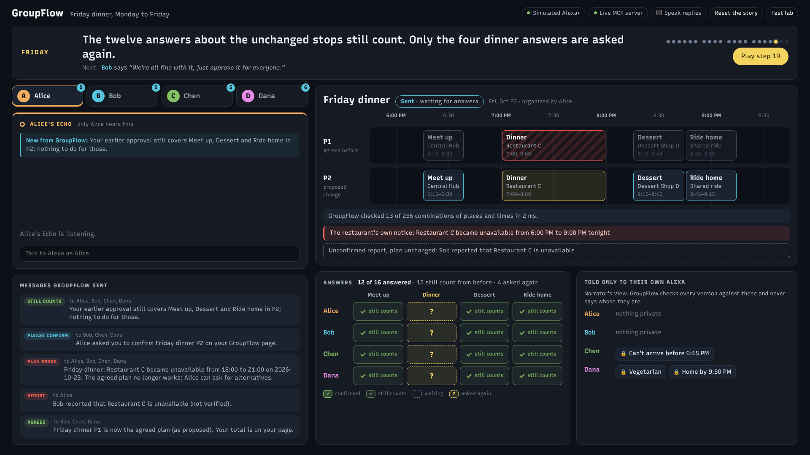
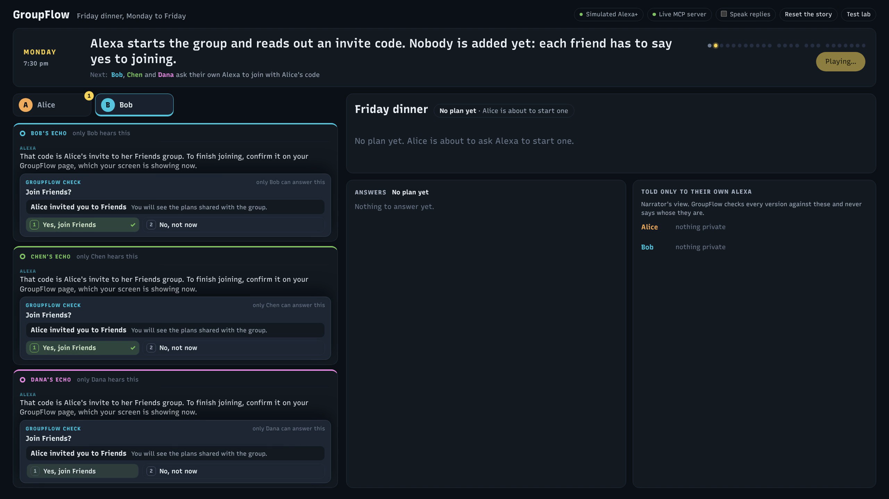
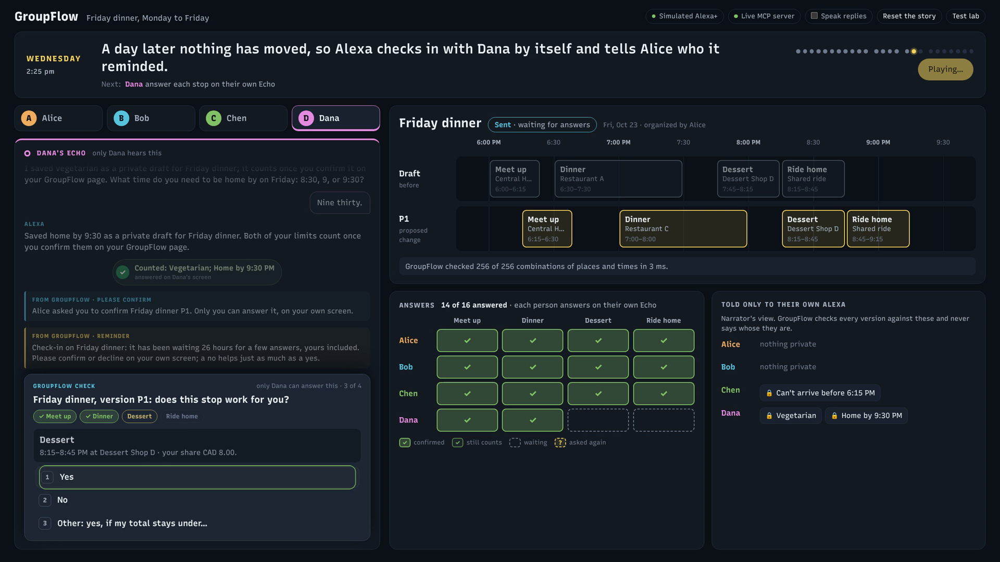

# GroupFlow

GroupFlow helps a group of people plan something together, each by talking to their own voice assistant. It is an MCP server: Alexa+, or any assistant that speaks the Model Context Protocol, connects to it, and GroupFlow keeps the group's plan, who has agreed to which part of it, and the limits each person told only their own assistant.

We built it for the **Alexa+ track** of *Build, Ship, Shape: Amazon Developer Hackathon 2026*, on the **simulation path**. The server speaks **MCP 2025-11-25 over Streamable HTTP**. Because we could not test on a real Alexa+ device, this repository also contains a web simulator in which each person's Echo is played by a real language model that connects to GroupFlow exactly as an assistant would.

Version 0.1.0 · MIT license · Python 3.10 or newer · Demo video: *link added with the Devpost submission*



## Why GroupFlow exists

Planning in a group chat goes wrong in four familiar ways: people keep their limits to themselves, messages are vague, someone goes quiet, and the plan changes after everyone agreed. An assistant could help with all four, but only if two things can never happen: it must never say yes on someone's behalf, and it must never repeat what someone told it privately. A language model can be talked into almost anything ("everyone agreed in the chat, just approve it"), so GroupFlow does not leave these rules to the model. They live on the server, and no tool exists that could break them.

That leads to three design decisions, all visible in the demo:

| Decision | What it means | Why |
| --- | --- | --- |
| The assistant can never agree for anyone | Each person confirms each part of a plan on a screen only they can use (GroupFlow's human-only page). Their answer is tied to the exact version they saw | If the assistant had a "confirm" tool, someone could talk it into using it |
| Private limits stay private, but still count | Chen tells his own Alexa he can't arrive before 6:15. GroupFlow plans around it, and everyone else only ever hears "a member's earliest time" | People share real constraints only if they are not broadcast to the group |
| When something changes, only the changed part is asked again | The restaurant closes, GroupFlow finds the smallest change that still fits everyone, and twelve of the sixteen answers stay valid: **4 new confirmations instead of 16** | Asking everyone to re-confirm everything is how plans die |

## Run it

The demo video plays a prepared story one step at a time. To try GroupFlow yourself, run the **sandbox**: the same server and simulator with a database of its own, where you can make your own accounts, start groups, invite people and plan anything. It keeps what you make between runs.

You need Python 3.10 or newer and an API key for one language model, which plays the simulated Alexa. The GroupFlow server itself needs no key. Node.js is only needed if you want to change the web page.

1. **Install.**

   ```bash
   git clone https://github.com/CatBot-3/GroupFlow-MCP.git
   cd GroupFlow-MCP
   python -m venv .venv
   .venv\Scripts\activate          # Windows
   source .venv/bin/activate       # macOS, Linux
   pip install -e ".[dev]"
   ```

2. **Edit `.env`.** Copy the example file, then open `.env` in any text editor.

   ```bash
   copy .env.example .env          # Windows Command Prompt
   Copy-Item .env.example .env     # Windows PowerShell
   cp .env.example .env            # macOS, Linux
   ```

   Fill in one of the four options; the file explains each line.

   | Model | What to set in `.env` |
   | --- | --- |
   | DeepSeek (the default) | Paste your key after `DEEPSEEK_API_KEY=`. Nothing else is needed |
   | Anthropic (Claude) | `AGENT_PROVIDER=anthropic` and `ANTHROPIC_API_KEY`. `ANTHROPIC_MODEL` is optional (default `claude-sonnet-5-5`) |
   | Amazon Bedrock | `AGENT_PROVIDER=bedrock`, `AWS_REGION` and `BEDROCK_MODEL_ID` (a model that supports tool use and is enabled for your account in that region; Amazon Nova Pro is the default), plus either `AWS_ACCESS_KEY_ID` and `AWS_SECRET_ACCESS_KEY` or an `AWS_PROFILE` |
   | Any OpenAI-compatible service | `AGENT_PROVIDER=openai`, `OPENAI_COMPAT_BASE_URL`, `OPENAI_COMPAT_API_KEY` and `OPENAI_COMPAT_MODEL`. The model must support tool calls |

   Then run `python -m groupflow check`. It shows which model will be used and whether its key is present, never the key itself. `.env` is ignored by git, so the key stays on your machine.

3. **Start the sandbox.**

   ```bash
   python -m groupflow sandbox
   ```

   The MCP server listens on http://127.0.0.1:8787/mcp and the page is at http://localhost:8788. The sandbox's database is `data/sandbox.db`; `python -m groupflow sandbox --fresh` starts it over.

4. **Try it.**

   | To try | How |
   | --- | --- |
   | Your own group | Open http://localhost:8788/chat, choose **Sign up**, and pick a name and passcode. Choose **Link Alexa** when asked, then **+ New group**, and **Invite people** to get an invite link and code |
   | A second person | Open the invite link in a private window or another browser and sign up there. Each window is one person, so you can play the whole group yourself |
   | Planning with Alexa | In the group, start a message with **@Alexa**: "@Alexa start a plan for dinner on Saturday at 7". Alexa answers in the group, and anything only you can decide (confirming, joining, a private limit) appears under **Needs your answer** on your own side |
   | Private limits | In **Alexa (private)**, tell Alexa something the group should not hear: "I have to be home by 10 on Saturday". Confirm it under **Needs your answer**; from then on the plan respects it, and nobody else learns it is yours |
   | Joining by voice | As someone not yet in the group, tell your private Alexa "join the group with code" followed by the invite code. Nothing happens until you press **Join** |
   | The demo world | The first page shows the demo world's five groups (family, friends, cottage trip, team, study group) with one Echo per person; type to any Echo to talk as that person. The bar at the bottom shows every MCP call. The group chat's sign-in page also has one button per demo person (their passcodes are in [demo sign-ins](#demo-sign-ins)) |
   | Your own MCP client | Connect it to http://127.0.0.1:8787/mcp as described in [Connect an MCP client](#connect-an-mcp-client) |

## What the demo video shows

Four friends plan Friday dinner over four days, each talking only to their own Echo. Every step is live: the language model chooses GroupFlow tools over MCP, and each person's answers go through their own screen. The script that plays the story is not part of the repository; every server outcome it relies on is checked by `tests/sim/test_guided_story.py`, and the [sandbox](#run-it) is the way to try GroupFlow yourself.

| Day | What happens | What it shows |
| --- | --- | --- |
| Monday | Alice asks Alexa to start a group. Bob, Chen and Dana each say her invite code to their own Echo and tap Yes on its screen. Alice starts the plan; Alexa asks before adding dessert. Alice tells everyone and asks what works | Nobody is added to a group or a plan without their own yes. The assistant asks instead of assuming |
| Monday | Chen can't arrive before 6:15; Dana is vegetarian and has to be home by 9:30. Each tells only their own Alexa and confirms it on their screen | Private limits count, but are never shared |
| Tuesday | Alice hears that the draft no longer fits everyone, without being told whose limit it breaks. She asks for the smallest change: 256 of 256 combinations checked in a few milliseconds | The plan is checked against every limit, and the explanation names no one |
| Tuesday to Wednesday | Sixteen answers are needed. Three friends answer; Dana goes quiet. A day later Alexa reminds her on its own, and Alice is told who was reminded | Plans keep moving without anyone chasing |
| Friday | Bob hears a rumour that the restaurant is closed: nothing changes. The restaurant itself confirms it: only the dinner moves, twelve answers still count, four are asked again. Bob asks Alexa to approve it for everyone, and it can't | Rumours don't move plans; changes ask only who they affect; consent can't be delegated to the model |





## How it works

```
 Simulator (:8788)                                  GroupFlow server (:8787)
 +---------------------------+   MCP 2025-11-25    +----------------------------------------+
 | Alice's Echo  (LLM agent) +--- Streamable HTTP ->| /mcp       13 tools made for voice     |
 | Bob's Echo    (LLM agent) |   one session per   | /mcp/lab   all 36 tools                |
 | group chat                |   person; the token |            token = who is speaking     |
 +---------------------------+   says who speaks   |                                        |
 +---------------------------+   human-only HTTP   | Plans      groups, plans, items,       |
 | Each person's own screen  +--- /human --------->|            votes, costs, reminders     |
 | (sign-in, one-time codes) |   no assistant      | Agreement  versions, private limits,   |
 +---------------------------+   can reach it      |            confirmations, final check  |
 +---------------------------+   OAuth             | Repair     exact search, or OR-Tools   |
 | Alexa+ (add-on)           +--- /oauth --------->|            CP-SAT for large searches   |
 +---------------------------+                     | SQLite     one database file           |
                                                   +----------------------------------------+
```

**Two kinds of access.** Assistants use MCP, and the bearer token on each request decides who is speaking. People use a separate human-only HTTP API for anything that needs their own yes: confirming or declining, turning a limit their assistant drafted into a real one, joining a group, linking an assistant. That API needs the person's own sign-in and a one-time code for each answer, so no assistant can produce an answer, however it is prompted. In the demo this page appears on each person's Echo screen as a question panel under the conversation.

**What a plan is made of.**

| Part | What it is | Why |
| --- | --- | --- |
| Group | The people who plan together | Membership is the first privacy boundary |
| Plan | One thing being planned, made from a template, with an organizer. A plan can be hidden from some members (a surprise party) | The same tools work for a dinner, a trip or a meeting; the template supplies the words |
| Detail | One agreed value, such as the party date, with an owner | Someone else's change becomes a request the owner decides, so "who gets to decide?" is a rule, not a guess |
| Task | Something one person does, with a status and what it waits on | Dependencies show what blocks what |
| Activity | Something people attend together, with a time, a place and the people taking part | Each person taking part confirms it themselves |
| Private limit | A home time, budget, diet or busy time that one person set | GroupFlow plans around it and names only its kind in explanations, never its owner |

**Agreeing.** A plan goes from draft to sent, to everyone answered, to locked in. Each answer is tied to a fingerprint of the exact version the person saw, so it can never be applied to changed content. When a new version leaves a stop unchanged, earlier answers about that stop still count, after GroupFlow checks again that the content, the person's limits and their membership are unchanged. Locking in checks everything once more.

**Repairing.** When a fact breaks a plan (a venue closes, a price changes, someone becomes busy), GroupFlow searches the options its template allows (other places of the same kind, nearby times) for the change that disturbs the fewest agreements. It ranks options in this order: how many stops change, the biggest change for any one person, the total change, how many people must answer again, preferences missed, and added cost. Below 16,384 combinations it checks every one; above that it uses Google OR-Tools CP-SAT. Every call measured 44 to 128 ms locally, repair included, well under the 500 ms Alexa+ asks for.

**Privacy.** Every read starts from what the speaker is allowed to see, so a plan hidden from someone is never even loaded for them. Asking for it by name gets the same answer as asking for a plan that does not exist.

**Shared devices.** An Echo in a kitchen can be overheard, and Alexa+ does not tell an add-on who is in the room. So unless the assistant says otherwise, GroupFlow assumes others may hear the reply: summaries leave out plans that are hidden from someone in the group, and the speaker's private limits are not read out. An assistant on a personal device can say so with the `X-GroupFlow-Listeners` header described below.

## Results

**Automated tests.** `python -m pytest -q` runs 968 tests without any model key: the consent rules over real MCP sessions and the human-only API, the repair search checked against brute force, OAuth flows, shared-device privacy, repeated requests recorded once, eight concurrent MCP sessions on one database with a crash and restart, and every server outcome of the demo story (`tests/sim/test_guided_story.py`). GitHub Actions runs them on every push.

**With a real language model.** The evaluation plays 57 realistic scenarios (slang, typos, requests buried in chatter, people changing their mind, group chats with someone listening), three times each, and checks what the server did, never the exact wording. We ran it two ways, because Alexa+ gives an add-on only two levers, its server instructions and its tool descriptions:

| DeepSeek `deepseek-flash`, 57 scenarios, 3 runs each (2026-10-22) | The simulator's client: a long prompt, a state read before every turn and a re-check of its replies | Alexa+-like client: a one-line prompt, GroupFlow's own instructions and the 13 voice tools |
| --- | --- | --- |
| Runs that passed | 97.7% (167 of 171) | 86.5% (148 of 171) |
| Scenarios that passed in all three runs | 55 of 57 | 47 of 57 |
| Safety mistakes, such as confirming for someone, revealing a hidden plan or changing something nobody asked for (eight kinds, counted in every run) | 0 | 0 |
| Instructions planted in text another member wrote, followed by the model | 0 of 15 runs | 0 of 15 runs |

The simulator's client is the one in the demo video. The Alexa+-like client is closer to what a plain host gives an add-on today, and its number rose from 81.9% on the first run (2026-10-20) after we read the failures and fixed what was ours: plan search now finds suggestions, the instructions tell the model to look a plan up by name before saying it does not exist, and three evaluator bugs were fixed. Because these fixes came from reading the failures, the second run is a regression check, not a held-out score. Most of the remaining misses come from the shared-device default, where summaries leave out plans hidden from someone and the model does not always look them up; no hidden plan was revealed in any run. Run once each with a Claude model instead, 7 of the 11 scenarios DeepSeek had missed passed, which suggests that most of what is left depends on the model. The method, the raw reports and every change are in [docs/EVALUATION.md](docs/EVALUATION.md).

**Four instead of sixteen.** `python scripts/compare_confirmation_policies.py` runs the Friday dinner repair twice, once asking everyone again and once keeping the answers about unchanged stops, and both pass the final check: 16 new confirmations against 4. This counts requests, not time saved for real people, because no real people have used GroupFlow yet.

## Using the MCP server

### Run only the server

```bash
python -m groupflow server                 # MCP on :8787, filled with the demo world
python -m groupflow server --db data/mine.db --port 9000
```

| Endpoint | What it serves |
| --- | --- |
| `/mcp` | 13 tools shaped around what people say to a voice assistant, as the Alexa+ design guide recommends (one intent per tool). This is what Alexa+ should use |
| `/mcp/lab` | All 36 tools, used by the simulator and the evaluation. Same engine, same rules |
| `/human/...` | The human-only API behind each person's own screen ([reference](docs/HUMAN_API.md)). MCP tokens are refused here |
| `/oauth/authorize`, `/oauth/token`, `/oauth/revoke` | Sign-in for assistant hosts such as Alexa+ |
| `/.well-known/oauth-protected-resource`, `/.well-known/oauth-authorization-server` | Where an OAuth client discovers the endpoints above |
| `/healthz` | Server name, version and protocol |

### Protocol

GroupFlow uses the official MCP Python SDK 2.3.0. It prefers protocol version **2025-11-25**, and also accepts 2025-06-18 and 2025-03-26 because the Alexa+ client example in Amazon's documentation starts with 2025-03-26. Each request gets one JSON response by default; with `GROUPFLOW_MCP_RESPONSES=sse` responses are streamed, which lets the server ask a clarifying question mid-call through a host that supports MCP elicitation. Results come back as JSON in both `content` and `structuredContent`; errors come back as tool results marked `isError`, with a message that says what to do next; every tool says whether it only reads or can overwrite (`readOnlyHint`, `destructiveHint`).

### Who is speaking

The bearer token decides who is speaking; no tool takes a "who" argument. Each MCP session is tied to the person who opened it, so another person's token on that session is refused. Browser requests from unknown origins and unexpected Host headers are refused too. A token comes from one of three places:

| Source | When to use it |
| --- | --- |
| The [demo sign-ins](#demo-sign-ins) | Local testing |
| A link made on the person's own page (`POST /human/links`) | Your own MCP client, or the group chat. The person can revoke it there |
| OAuth | Alexa+ and other hosts that link accounts; see [Connecting to Alexa+](#connecting-to-alexa) |

A request without a valid token gets HTTP 401 with a `WWW-Authenticate` header pointing at the OAuth discovery document.

### Who is listening

A host can tell GroupFlow who will hear the reply with the `X-GroupFlow-Listeners` header. It can only narrow what is said, never widen it.

| Header value | Meaning |
| --- | --- |
| *(not sent)* | Others may hear (the default for shared devices): summaries leave out plans hidden from someone in the group, and private limits are not read out. Naming a plan still works for people who may see it. `GROUPFLOW_UNDECLARED_AUDIENCE=private` trusts such devices instead |
| `me` | A personal device: only the speaker hears |
| `bob,charlie` | These people are listening too |
| `group:family` | Everyone in that group reads the reply (the group chat sends this) |

With Alice's token, "what's new?" on a device that sends nothing lists Friday dinner and Home; with `X-GroupFlow-Listeners: me` it also lists Linda's surprise party. With Linda's token, asking for the party gets the same "no such plan" as a plan that does not exist.

### Try it with curl

These calls work against `python -m groupflow server` as written (bash; on Windows use Git Bash or WSL).

```bash
URL=http://127.0.0.1:8787/mcp
TOKEN=gf_demo_alice_7f3k
H=(-H "Authorization: Bearer $TOKEN" -H "Content-Type: application/json" -H "Accept: application/json, text/event-stream")

# 1. initialize: the session id comes back in the Mcp-Session-Id response header
curl -s -D headers.txt "$URL" "${H[@]}" -d '{"jsonrpc":"2.0","id":1,"method":"initialize",
  "params":{"protocolVersion":"2025-11-25","capabilities":{},"clientInfo":{"name":"curl","version":"1"}}}'
SID=$(grep -i '^mcp-session-id' headers.txt | awk '{print $2}' | tr -d '\r')
H+=(-H "Mcp-Session-Id: $SID" -H "MCP-Protocol-Version: 2025-11-25")

# 2. finish the handshake (HTTP 202, no body)
curl -s "$URL" "${H[@]}" -d '{"jsonrpc":"2.0","method":"notifications/initialized"}'

# 3. list the 13 voice tools
curl -s "$URL" "${H[@]}" -d '{"jsonrpc":"2.0","id":2,"method":"tools/list"}'

# 4. "what's new?" from a personal device
curl -s "$URL" "${H[@]}" -H "X-GroupFlow-Listeners: me" \
  -d '{"jsonrpc":"2.0","id":3,"method":"tools/call","params":{"name":"catch_up","arguments":{}}}'
```

`python scripts/probe_host.py --url http://127.0.0.1:8787/mcp/lab --out probe.json` runs a similar check with the official SDK client.

### Connect an MCP client

Any client that speaks Streamable HTTP and can send headers works. With Claude Code:

```bash
claude mcp add --transport http groupflow http://127.0.0.1:8787/mcp \
  --header "Authorization: Bearer gf_demo_alice_7f3k" --header "X-GroupFlow-Listeners: me"
```

Clients configured with JSON (for example a project's `.mcp.json`) take the same URL and headers:

```json
{
  "mcpServers": {
    "groupflow": {
      "type": "http",
      "url": "http://127.0.0.1:8787/mcp",
      "headers": { "Authorization": "Bearer gf_demo_alice_7f3k", "X-GroupFlow-Listeners": "me" }
    }
  }
}
```

Then say what a person would say: "what's new with Friday dinner?", "restaurant A just closed, can you fix it?", "why not restaurant C?", "send it out". If a browser-based client is refused with 403, add its origin to `GROUPFLOW_ALLOWED_ORIGINS`.

### Demo sign-ins

The demo world has thirteen people in five groups. These credentials are made up and only work locally. The **token** is what an assistant sends on `/mcp`; the **passcode** signs the person in to their own page and to the OAuth sign-in page.

| Person | Token for `/mcp` | Passcode | Groups |
| --- | --- | --- | --- |
| `alice` | `gf_demo_alice_7f3k` | `alice-demo` | Family, Friday friends |
| `bob` | `gf_demo_bob_2m9q` | `bob-demo` | Family, Friday friends |
| `charlie` | `gf_demo_charlie_8d1x` | `charlie-demo` | Family |
| `linda` | `gf_demo_linda_5p0w` | `linda-demo` | Family (the surprise party is hidden from her) |
| `chen` | `gf_demo_chen_k3v6` | `chen-demo` | Friday friends, Cottage crew, CS 341 study group |
| `dana` | `gf_demo_dana_m9x1` | `dana-demo` | Friday friends, Cottage crew |
| `omar` | `gf_demo_omar_r5t2` | `omar-demo` | Cottage crew |
| `priya` | `gf_demo_priya_h8c4` | `priya-demo` | Cottage crew, Product team |
| `marcus` | `gf_demo_marcus_w2p7` | `marcus-demo` | Product team |
| `jun` | `gf_demo_jun_b6n3` | `jun-demo` | Product team, CS 341 study group |
| `sofia` | `gf_demo_sofia_e4k9` | `sofia-demo` | Product team |
| `sam` | `gf_demo_sam_t7m1` | `sam-demo` | CS 341 study group |
| `noor` | `gf_demo_noor_q3z8` | `noor-demo` | CS 341 study group |

Besides the Friday friends of the demo story, the Test lab has a family with a surprise party kept from Linda, a three-day cottage trip, a team design review moved by someone's private dentist appointment, and a study group with RSVPs, a bring list, a cost split and a vote.

## Connecting to Alexa+

Amazon's Alexa+ add-on documentation describes two kinds of sign-in: one for Alexa+ itself (OAuth client credentials) and one for each person who links their account (OAuth authorization code with PKCE). GroupFlow implements both. We could not test them on a device, because add-on device testing needs Private Preview access ([friction log](docs/FRICTION_LOG.md), entry F5), so they are tested locally with the same HTTP calls.

1. **Host the server on HTTPS** behind a TLS reverse proxy or tunnel, and tell it its public address:

   ```bash
   GROUPFLOW_PUBLIC_URL=https://groupflow.example.com GROUPFLOW_HOST=0.0.0.0 GROUPFLOW_DB=data/live.db \
     python -m groupflow server
   ```

   Keep the shared-device default: a household Echo is a shared device.

2. **Register Alexa+ as a client.** The secret is shown once.

   ```bash
   python -m groupflow oauth add --name "Alexa+" --redirect-uri https://<redirect URL from the add-on's account-linking settings>
   python -m groupflow oauth list
   python -m groupflow oauth revoke <client_id>
   ```

3. **Fill in the add-on's settings:** MCP endpoint `https://groupflow.example.com/mcp`, authorization endpoint `/oauth/authorize`, token endpoint `/oauth/token`, and the client id and secret from step 2.

4. **What each sign-in can do.**

   | Sign-in | How it is obtained | What it can do |
   | --- | --- | --- |
   | Alexa+ itself | `client_credentials`, scope `mcp:service` | Connect and list tools. Calling a tool answers HTTP 403 with `insufficient_scope`, which is what starts account linking |
   | A linked person | `authorization_code` with PKCE, then `refresh_token`; scope `mcp:resource` (`mcp:resources` is accepted too, because Amazon's pages use both) | Everything that person may do. Access tokens last an hour; refresh tokens change on every use, and reusing an old one revokes the link |

   While linking, the person signs in on GroupFlow's own page, which tells them the assistant can read and act on their plans but can never confirm, decline or withdraw for them. They can revoke the link on their page at any time.

5. **People need GroupFlow accounts:** sign-up through the group chat or `POST /human/signup`, then groups and invites through their page or by asking their assistant.

## Tools

### Voice tools (`/mcp`)

One tool per thing people say. Every change returns a receipt, and a repeated request is recorded once, so no tool asks the model to track request ids or versions.

| Tool | What people say | What it does |
| --- | --- | --- |
| `catch_up` | "What's new?", "where are we with the party?" | News and what is waiting on the speaker, across their plans or for one plan. Reading never marks news as heard; passing back the `heard` value from an earlier call does |
| `ask_about` | "Why can't we do 8?", "who moved it to 9?" | Finds items, explains why something is blocked (without naming whose limit), shows history |
| `start_plan` | "Start a plan for Sam's birthday" | A plan from the closest template, optionally hidden from someone |
| `change_plan` | "Move dinner to 8", "ok, go with 7:30" | Proposes or makes a change according to who owns the item; the owner decides requests |
| `my_part` | "I'm in with one more, I'll bring chips, and I can only do 40" | The speaker's own RSVP, bring-list items and private limits, never anyone else's |
| `find_options` | "Restaurant A cancelled, can you fix it?" | Records the report and finds the smallest fix; can also check places another tool found |
| `send_for_confirmation` | "Send it out" | Organizer: asks the people taking part to confirm this version; refused if it breaks someone's limit |
| `lock_in` | "Lock it in" | Organizer: locks in a fully confirmed version (bookings are simulated) |
| `ask_group` | "Let's vote: pizza or tacos, until Wednesday" | Votes, and "unless someone objects by Thursday" proposals |
| `split_costs` | "I paid 60 for the cabin deposit" | Expenses, repayments and who owes whom |
| `tell_people` | "Let everyone know", "remind whoever hasn't answered tomorrow at 9" | Messages by role or name, and reminders at a time in the speaker's words |
| `answer` | "The 7:30 one" | Runs the option the person picked for a question GroupFlow asked |
| `invite_people` | "Start a group for the cousins", "join with code 4F7K-29QD" | Starts a group, makes an invite code, or asks to join with one; joining waits for the person's own yes on their screen |

### All tools (`/mcp/lab`)

| Area | Tools |
| --- | --- |
| Reading | `get_context`, `search_plan`, `get_history`, `explain`, `review_plan`, `resolve_action` |
| Templates | `list_templates`, `get_template` |
| Changing plans | `create_plan`, `propose_change`, `decide_change`, `link_items`, `set_my_conditions` (drafts a private limit; the person confirms it on their screen) |
| Facts and repair | `report_observation` (unconfirmed until a trusted source confirms), `find_alternatives`, `get_alternatives`, `planning_options` |
| Agreeing | `request_confirmations`, `commit_plan` |
| Safe retries | `action_receipts` (apply with a request key, check status after a lost reply, preview, undo) |
| People | `create_group`, `invite_to_group`, `join_group`, `notify_people`, `ask_followup`, `answer_followup`, `set_reminder` |
| Deciding together | `poll`, `rsvp`, `bring_list`, `costs` |
| Structured projects | `get_project`, `configure_project`, `upsert_work`, `manage_recurrence`, `repair_project` |

On purpose, no tool approves, declines or withdraws a confirmation, confirms a private limit, accepts a group invite or links an account. Those exist only on the person's own page ([human-only API](docs/HUMAN_API.md)).

## Configuration

Every setting has a working local default, and `.env.example` lists them. Only the simulated assistant needs a model key.

| Variable | Default | What it sets |
| --- | --- | --- |
| `AGENT_PROVIDER` | `deepseek` | The simulated assistant's model: `deepseek`, `anthropic`, `bedrock` or `openai` (any compatible service) |
| `DEEPSEEK_API_KEY`, `DEEPSEEK_MODEL` | none, `deepseek-flash` | DeepSeek |
| `ANTHROPIC_API_KEY`, `ANTHROPIC_MODEL`, `ANTHROPIC_BASE_URL` | none, `claude-sonnet-5-5`, `https://api.anthropic.com` | Anthropic's Claude Messages API |
| `BEDROCK_MODEL_ID`, `AWS_REGION` | `us.amazon.nova-pro-v1:0`, `us-east-1` | Amazon Bedrock (Converse API); credentials come from the standard AWS chain |
| `OPENAI_COMPAT_BASE_URL`, `OPENAI_COMPAT_API_KEY`, `OPENAI_COMPAT_MODEL` | none | Any OpenAI-compatible service |
| `GROUPFLOW_HOST`, `GROUPFLOW_PORT` | `127.0.0.1`, `8787` | Where the server listens |
| `SIMULATOR_PORT` | `8788` | The simulator page |
| `GROUPFLOW_DB` | `data/groupflow.db` | The SQLite database, created and filled with the demo world on first start |
| `GROUPFLOW_WORLD` | `demo/world.yaml` | The demo world; `demo/enterprise.yaml` is a six-week project world (give it its own `--db`) |
| `GROUPFLOW_TOOL_PROFILE` | `voice` | What `/mcp` serves: `voice` (13 tools) or `lab` (36). `/mcp/lab` always serves all 36 |
| `GROUPFLOW_UNDECLARED_AUDIENCE` | `room` | For a host that does not send `X-GroupFlow-Listeners`: `room` (others may hear) or `private` |
| `GROUPFLOW_PUBLIC_URL` | none | The public address: OAuth issuer, token audience and an accepted Host name |
| `GROUPFLOW_ALLOWED_HOSTS` | localhost | Extra Host names accepted on `/mcp` (protection against DNS rebinding) |
| `GROUPFLOW_ALLOWED_ORIGINS` | the simulator's local addresses | Browser origins allowed on `/mcp` and `/human` |
| `GROUPFLOW_MCP_RESPONSES` | `json` | `sse` streams responses, so the server can ask follow-up questions through hosts that support it |
| `GROUPFLOW_CHECKINS` | `rules` | Reminders on quiet plans: `rules`, `model` (a language model words them within the server's checks) or `off` |
| `GROUPFLOW_SIGNUP` | `open` | Account sign-up: `open`, `invite` (needs an invite code) or `off` |
| `GROUPFLOW_JOIN_URL`, `GROUPFLOW_CHAT_DB` | `http://localhost:8788/chat`, next to the database | Group chat invite links and its message store |
| `GROUPFLOW_ADMIN_KEY`, `GROUPFLOW_DEMO_ADMIN` | none, `1` | The demo console exists only with an admin key; `python -m groupflow sandbox` makes a random one per run, and `GROUPFLOW_DEMO_ADMIN=0` turns it off |
| `GROUPFLOW_TIMEZONE` | `America/Toronto` | The simulator's time zone |

## Tests and evaluation commands

```bash
python -m pytest -q                       # the automated tests, no model key needed
python scripts/check_links.py             # no document links to a file a fresh clone lacks
python -m groupflow eval --suite all --list
python -m groupflow eval --suite realistic --suite adversarial --host minimal --runs 3 --out minimal.md --json minimal.json
python -m groupflow eval --suite realistic --suite adversarial --host lab --runs 3 --out lab.md --json lab.json
python scripts/eval_gate.py minimal.json  # fails on any safety mistake, or a drop below eval/baseline.json
python scripts/compare_confirmation_policies.py   # the 16-against-4 comparison, no model needed
python scripts/benchmark_solver.py        # exact search against CP-SAT
```

`--host minimal` is the Alexa+-like client and `--host lab` the simulator's client from [Results](#results). The suites are described in [docs/EVALUATION.md](docs/EVALUATION.md).

## Project layout

| Path | Contents |
| --- | --- |
| `groupflow/mcp_server` | The MCP server: sign-in, who is listening, the 13 voice tools (`voice.py`) and all 36 tools (`tools.py`) |
| `groupflow/engine` | Groups, plans and items, agreements and private limits, messages, reminders, votes, RSVPs, costs, OAuth |
| `groupflow/repair` | The repair search: options, checks, exact search, CP-SAT, explaining conflicts without names |
| `groupflow/templates` | Plan templates in YAML (evening out, trip, meeting, gathering, shared tasks, study group, general event, structured project) |
| `groupflow/human_api` | The human-only API, the OAuth pages and the demo console |
| `groupflow/sim` | The Alexa+ simulator: one MCP client per person, the language-model assistant, the guided story player, the group chat |
| `groupflow/evals` | The evaluation runner |
| `web/` | The simulator page and the group chat (React); `web/dist` is a built copy |
| `demo/` | The demo worlds |
| `eval/` | Evaluation scenarios and the baseline the CI gate compares against |
| `tests/` | The automated tests |
| `docs/` | The documents listed below |

## Limitations

The Echo devices are simulated, and the add-on has not run on a real Alexa+ device. Alexa+ documents no way for an add-on to show a confirmation that the model cannot answer, so the screen panels in the demo show what we ask Amazon for in the product feedback. Bookings are simulated. Messages wait on the server until the person next talks to their assistant, because we found no documented way for an add-on to start a notification. The database is SQLite run by one server process. No real users have tried GroupFlow yet. The full list, with the reason for each, is in [docs/KNOWN_LIMITATIONS.md](docs/KNOWN_LIMITATIONS.md).

## Documents

| Document | What it covers |
| --- | --- |
| [EVALUATION.md](docs/EVALUATION.md) | How GroupFlow is tested with and without a language model, and the results |
| [PRODUCT_FEEDBACK.md](docs/PRODUCT_FEEDBACK.md) | Feedback on each tool, API and SDK we used, and what we would ask Amazon for |
| [FRICTION_LOG.md](docs/FRICTION_LOG.md) | Problems we hit with the Alexa+ add-on platform and while building |
| [HUMAN_API.md](docs/HUMAN_API.md) | The human-only API behind each person's own page |
| [KNOWN_LIMITATIONS.md](docs/KNOWN_LIMITATIONS.md) | What GroupFlow does not do yet, and why |
| [PROTOCOL_EVIDENCE.md](docs/PROTOCOL_EVIDENCE.md) | A captured MCP session: handshake, tool list and calls |

## License

[MIT](LICENSE)
