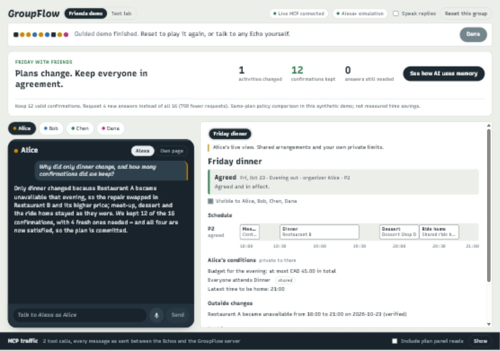
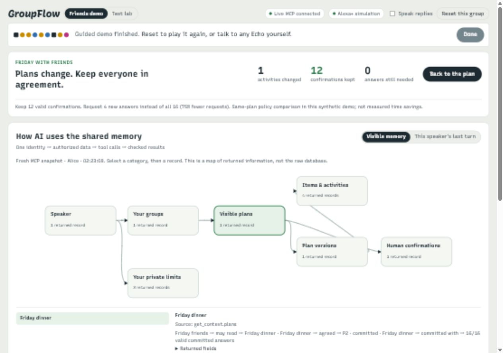
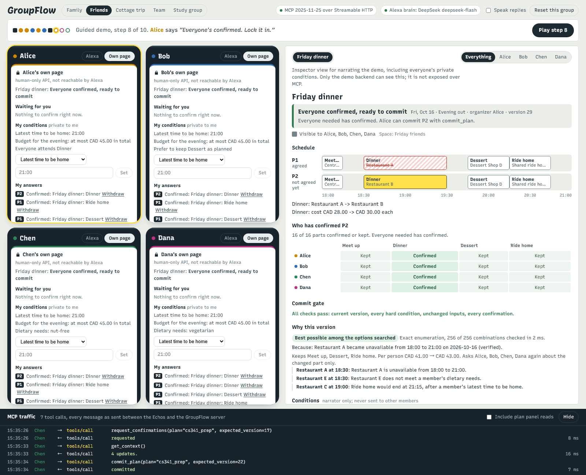
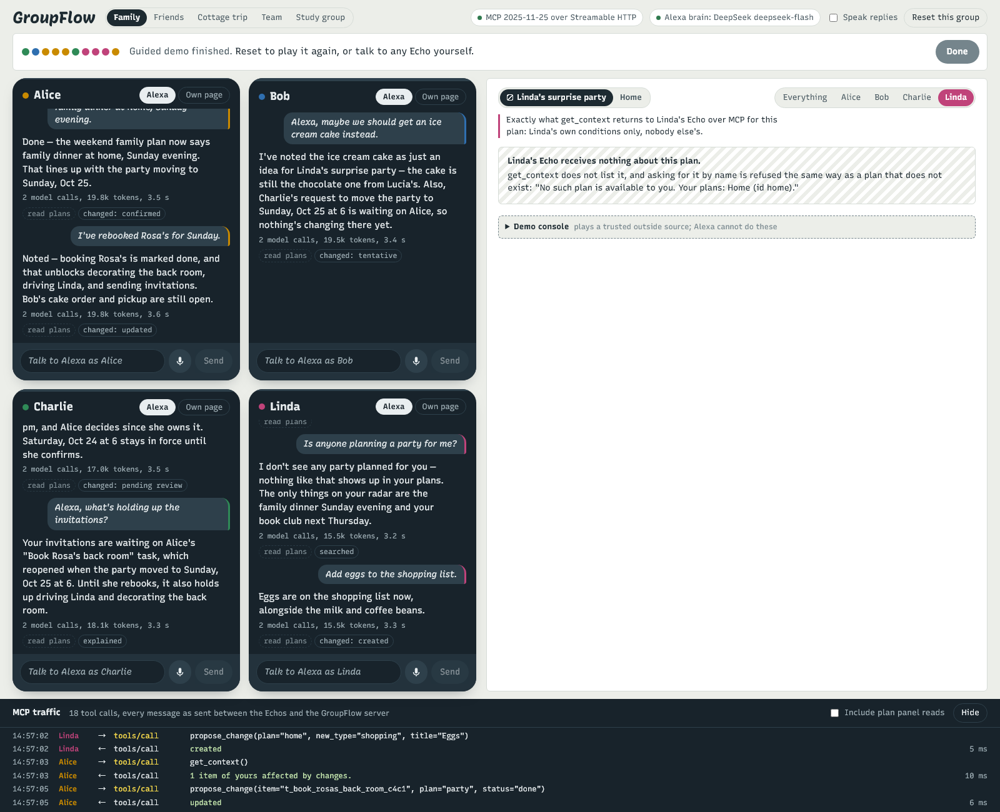
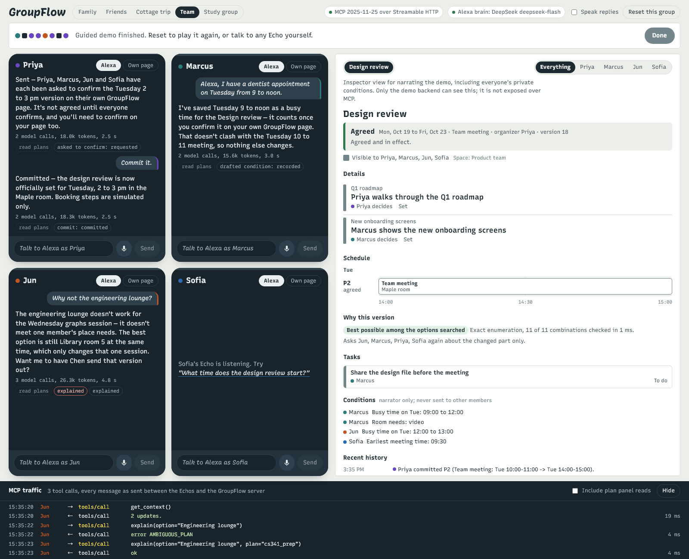

# GroupFlow

GroupFlow is a shared planning MCP server demonstrated through an Alexa+ web simulation. Four friends have agreed a Friday evening; their restaurant closes. The assistant reads their authorized shared memory, finds the smallest valid repair, preserves confirmations for unchanged parts, and asks each person to confirm only the changed dinner. The model can propose and commit a ready plan, but cannot give anyone's consent.

There is one generic core with fourteen core MCP tools, two template discovery tools, five structured-project tools and two group tools. Ordinary item-based scenarios vary through YAML templates describing items, decision policies, private conditions and optional places. Structured long-term projects additionally use a dedicated interval scheduler and project workflow. The other scenarios are a test lab for the MCP structure and model behavior, rather than competing demo stories.

Built for the **Build, Ship, Shape: Amazon Developer Hackathon 2026**, Alexa+ track (self-hosted MCP server, spec 2025-11-25, Streamable HTTP).

## The idea in one paragraph

Group plans go wrong in three ways: someone changes a thing that was not theirs to change, an agreement quietly stops holding when a fact changes, or something meant for some people reaches the wrong person. GroupFlow answers each one on the server instead of trusting the model. Every item has a consent policy, so a change from someone who does not own an item waits for its owner. Activities that people attend together count only after each person confirms them on their own page, bound to the exact version they saw, and a verified outside fact (a closed restaurant, a booked room) turns an agreed plan into one that no longer holds until it is repaired and confirmed again. Every plan lives in a space, and a space decides who can see it, so a surprise party is simply a plan whose space leaves the guest of honour out.

## Long-term projects (v0.4)

GroupFlow now supports parallel workstreams, structured deadlines/effort, recurring occurrences, shared resources, individual work commitments and separate stage authorization. Start the synthetic six-week release demo in a separate database:

```powershell
python -m groupflow demo --world demo/enterprise.yaml --db data/enterprise.db
```

Read [the implemented project workflow, architecture, migration and limits](docs/PROJECTS.md). The normal five-group demo remains available.

## Group chat: GroupFlow for real people (v0.6)

The demo world is fixed; the group chat is not. Open http://localhost:8788/chat while the demo runs: sign up, start a group, share the invite link, and talk. A message that starts with `@Alexa` (or `Alexa,`) asks the simulated Alexa+, which acts as the person who wrote it over that person's own MCP session. Each person also has a private thread with Alexa, and answers that need their consent appear as cards only they can tap, which go to their own GroupFlow page, never through the model. The demo world's people are pre-linked, so two browser tabs signed in as Alice and Linda show the family room.

In a room, everyone reads Alexa's reply, so the chat tells the MCP server who is listening (`X-GroupFlow-Listeners: group:<id>`), and the server narrows the speaker's scope to what every listener may see: Linda's surprise party is not in the family room at all, and nobody's private limits are read out to the group. The same declaration would serve a shared kitchen Echo. People join groups only with an invite they accept themselves, and let an assistant act for them only by linking it on their own page (simulated account linking, revocable). Read [the design, privacy model and limits](docs/GROUP_CHAT.md).


## What it looks like

The default **Friends demo** shows one speaker at a time, a live plan and server-derived change/confirmation counts. **See how AI uses memory** opens a read-only semantic map of that speaker's actual MCP results, with a separate last-turn trace. **Test lab** retains all groups, multi-person panels and the admin inspector. Raw MCP traffic is collapsed initially.

Read [the visualization design, evidence boundaries and test strategy](docs/MEMORY_VISUALIZATION.md). A fresh panel read is not labelled as model input; the last-turn view shows the exact compact tool messages actually delivered to a subsequent model request.







<details>
<summary>Additional structural test scenarios</summary>





</details>

The screenshots come from the guided demos running against the real server, with every Alexa reply written by DeepSeek in that run.

## How a plan is built

| Concept | What it is | Why it is there |
| --- | --- | --- |
| Group and space | People who plan together; a space is the part of the group that can see a plan | Visibility is decided once, by the space, so no tool can leak a plan to someone outside it |
| Plan | One thing being planned, made from a template, owned by an organizer | The same tools work on any plan; the template supplies the vocabulary |
| Detail | One agreed value (the party date, the meeting point) with an owner | Ownership turns "who gets to decide this?" into a rule instead of a guess |
| Task | Something one person does, with status, due date and what it waits on | Dependencies show what is blocking what, and finished work reopens when its inputs change |
| Activity | Something people attend together, with a time, a place and participants | Activities use participant confirmation; structured projects separately confirm owner work and stage authorization |
| Condition | A person's private limit: a home time, a budget, a diet, a busy window | The solver respects it and explanations mention its kind, never its owner |

Each item type has one of three policies. **Owner**: the owner decides; anyone else's change becomes a request to the owner (a "maybe" is only an idea). **Open**: anyone in the plan can change it, like a shopping list. **Participants**: each person taking part confirms on their own page, then the organizer commits.

## The demo world

The simulator ships with thirteen people in five groups. Some people are in several groups, so their Alexa has to keep several plans apart.

| Group | People | Plans (template) | What the guided demo shows |
| --- | --- | --- | --- |
| Family | Alice, Bob, Charlie, Linda | Linda's surprise party (surprise_party, hidden from Linda), Home (chores_shopping) | Charlie's date change waits for Alice; "maybe an ice cream cake" stays an idea; finished work reopens; Linda hears only the cover story, and asking about a party gets nothing |
| Friends | Alice, Bob, Chen, Dana | Friday dinner (evening_out) | Restaurant A closes; the smallest valid fix moves only the dinner to Restaurant B; "why not C?" is answered without naming whose limit it breaks; twelve approvals carry forward, only the dinner is asked again; Chen plans a picnic on the spot for three of them |
| Cottage trip | Dana, Chen, Omar, Priya | Cottage weekend (weekend_trip, three days) | The draft breaks Priya's private busy morning, so it is not sent; the fix moves only the hike by an hour; Omar's change becomes a request to the organizer; the minivan task unblocks after the commit |
| Team | Priya, Marcus, Jun, Sofia | Design review (team_meeting) | Marcus adds a dentist appointment and confirms it on his page; the agreed slot breaks; the search over the work week moves the meeting; "why not Birch?" says someone needs video |
| Study group | Chen, Sam, Noor, Jun | CS 341 midterm prep (study_group) | Noor's report that the room is closed stays unverified; the library confirms it; only the Wednesday session moves, to a quiet room |

## Quick start

You need Python 3.10 or newer. Node is only needed if you want to change the web page; a built copy is in `web/dist`.

1. Create an environment and install:

   ```
   python -m venv .venv
   .venv\Scripts\activate          (Windows)
   source .venv/bin/activate       (macOS, Linux)
   pip install -e ".[dev]"
   ```

2. Copy `.env.example` to `.env` and set `DEEPSEEK_API_KEY` (or choose another provider there). The file is git-ignored; the key is never printed or logged.

3. Start both servers and open the page:

   ```
   python -m groupflow demo
   ```

   Then open http://localhost:8788. The MCP server listens on http://127.0.0.1:8787/mcp.

4. The **Friends demo** opens by default. The group chat is at http://localhost:8788/chat (linked from the page header). Press **Play step 1** (or N) to follow its nine-step story, or talk to one speaker yourself. Choose **Test lab** for all other scenarios. Use a separate database such as `python -m groupflow demo --db data/friends-demo.db` for demonstration work; **Reset this group** intentionally restores that demo group.

`python -m groupflow check` shows the configuration, including whether the LLM key is present (never its value). The page's demo console can reset a group to a stage, report a place closed as a trusted source would, and clear Alexa's chat memory. `python scripts/play_demo.py` replays every group's guided story against the running demo and prints each reply and the final plan status, which is a quick way to check the stories before recording.

## How it works

```
 Echo page (simulator, :8788)                       GroupFlow server (:8787)
 ┌──────────────────────────┐   MCP 2025-11-25     ┌──────────────────────────────────────┐
 │ Alice's Echo ─ LLM agent ├──── Streamable HTTP ─►│ /mcp    bearer token = who speaks    │
 │ Bob's Echo   ─ LLM agent │    one session per    │         23 tools, permission checked  │
 │ ...                      │    person             │                                      │
 └──────────────────────────┘                      │ Engine   groups, spaces, plans,      │
 ┌──────────────────────────┐   human-only HTTP    │          items, requests, links      │
 │ Each person's own page   ├──── /human ──────────►│ Agreement revisions, conditions,     │
 │ (login, challenge, CSRF) │    no Alexa route     │          approvals, gate             │
 └──────────────────────────┘                      │ Repair   domain, enumeration, CP-SAT │
                                                   │ Templates  8 templates + legacy/presets          │
                                                   │ SQLite   one file, WAL               │
                                                   └──────────────────────────────────────┘
```

**The simulated Alexa.** Each Echo is an LLM with GroupFlow's tools. Every turn starts with `get_context(detail="summary")`: a paged plan index, a short template directory, pending work and details of the active plan only. The UI's selected plan is a hint; the server still checks the speaker's visibility. The agent remembers focus, refreshes it each turn and clears chat/focus when the group changes. Other plan details, a template specification and venue catalogs are read on demand. The expanded descriptions retain the short directory and focused context; current character measurements and API accuracy are reported separately, since shorter first requests do not imply fewer total tokens or better accuracy. See [context design and measurement](docs/CONTEXT_DESIGN.md). If a reply claims a change when no write tool ran, the model gets one automatic correction round. One generic prompt serves every group.

**Identity.** The MCP bearer token decides who is speaking, every session is bound to the person who opened it, and no tool takes a "who" argument. Browser origins are checked, and only the 2025-11-25 handshake is served. `docs/PROTOCOL_EVIDENCE.md` holds a captured run of the real traffic.

**Visibility.** Every read goes through the speaker's scope: the spaces they belong to. A plan outside it is not filtered out of a result after the fact; it is never loaded. Asking for a hidden plan by name returns the same answer as asking for one that does not exist, and the history of a shared plan never mentions a change that came from a hidden one.

**Agreements.** Activities move through draft, proposed, awaiting confirmations, ready to commit and committed. Each person confirms each activity they take part in, on their own page: a separate human-only API with its own sign-in, CSRF token and one-time challenges. An approval is bound to a digest of that activity and of the whole version, so it can never be replayed onto changed content. When a new version leaves an activity unchanged, the old approval carries forward only after re-checking the digest, the person's current conditions, their membership and expiry. The commit gate re-checks the version, every hard condition, unchanged inputs and every confirmation, and bookings after a commit are simulated with idempotency keys.

**Repair.** The solver searches a finite set of options for each activity (other places of the same kind, time shifts the template allows, other days for plans over several days) and minimises, in this order: activities changed, the largest change for any one person, total change, people asked to reconfirm, soft preferences missed, added cost. Auto routing uses enumeration below **16,384 combinations**, then OR-Tools CP-SAT for supported domains. Cancellable activities and options that may reorder the transfer chain use enumeration; missing OR-Tools also falls back. Proof records the actual method and fallback reason. The threshold comes from [180 benchmark cases and 1,080 timed searches](docs/SOLVER_BENCHMARK.md), with a script to recalibrate. Every candidate passes an independent validator, and the result is labelled as `optimal_within_domain`, `best_found`, `infeasible_within_domain` or `unknown`. When nothing fits, a deletion filter finds a reduced set of clashing condition kinds and reports them without naming anyone.

## MCP tools

| Tool | What it does |
| --- | --- |
| `get_context` | Fresh state; `summary` gives a paged index and one focused plan, `full` gives detailed views; returned updates can be marked read |
| `search_plan` | Find items and places by words, across the speaker's plans |
| `create_plan` | Start a plan from a template, optionally hidden from some people or limited to an audience |
| `propose_change` | Change or add a detail, task or activity; the item's policy decides whether it applies, waits for the owner, or goes to the organizer |
| `decide_change` | The owner accepts, rejects or amends a request |
| `link_items` | Make a task wait on another item, or watch a detail in another plan |
| `set_my_conditions` | Draft the speaker's own private conditions; they count after the person confirms them on their page |
| `report_observation` | A member's report that a place closed or a price changed; it stays unverified until a trusted source confirms it |
| `request_confirmations` | Send a version out; refuses a version that breaks a hard condition |
| `find_alternatives`, `get_alternatives` | Search for the smallest change that works and read the result |
| `commit_plan` | Commit a fully confirmed version through the gate |
| `explain` | Why something is blocked, why a version changed what it did, or why another option would not work, without naming anyone |
| `get_history` | Who changed what, with their own words when recorded |
| `list_templates` | Search and page short template summaries |
| `get_template` | Load one template's item types, policies, presets and condition formats, without its venue catalog |
| `get_project` | Page structured work and resource schedules |
| `configure_project` | Lead sets stage, budget, authorized approvers and rolling window; admin sets resources |
| `upsert_work` | Add/edit ISO dates, effort, workstreams, milestones, resource demand and dependencies |
| `manage_recurrence` | Create/expand independent DAILY/WEEKLY occurrences idempotently |
| `repair_project` | Propose a minimally changed parallel interval schedule; never approve or commit |
| `create_group` | Start a group with the speaker as organizer; nobody else is added |
| `invite_to_group` | Organizer: make an invite code and link; each person accepts it on their own page |

There is deliberately no tool that approves, declines or withdraws, accepts an invite or links an account. A host may declare who else will read a reply with the `X-GroupFlow-Listeners` header; the server then answers only with what every listener may see.

## Templates

| Template | Item types (policy) | Private conditions |
| --- | --- | --- |
| `gathering` | detail, task, activity (participants); surprise is an explicit preset | latest_end, busy, budget |
| `trip` | activity (participants), task, packing (open), detail | available_from, latest_end, budget, busy, prefer_keep |
| `meeting` | activity (participants), task, detail | busy, earliest_start, latest_end |
| `shared_tasks` | task (owner), list_item (open), detail; ongoing | none |
| `project` | structured task/milestone, project decision; 42-day default window | own-page work calendar; separate project scopes |
| `evening_out` | stop (participants), detail, task | home_by, available_from, budget, diet, accessibility, everyone_attends, prefer_keep |
| `study_group` | session (participants), prep, detail | busy, earliest_start, latest_end, budget, needs, prefer_keep |
| `general_event` | detail, task, activity (participants), list_item (open) | latest_end, earliest_start, budget, busy, prefer_keep |

Legacy ids remain supported with their original definitions. New plans freeze the template version. `days` means the planning window (1–366), not approval expiry; override it for a ten-day trip.

A template can also carry a catalog of places with opening hours, prices and tags, the time shifts its search may try, starter items, and which activity kinds produce bookings when committed. Conditions map a template's own name (home_by, room_needs) onto a small set of generic checks (latest end, needs, unavailable window, and so on), so the solver and the validator never learn what a dinner is.

Templates are discovered from YAML at process startup. Adding a template does not lengthen tool descriptions; the short directory is capped at 12 entries with pagination. The model reads one specification with `get_template`, then uses the plan context or `search_plan` for places. Restart the server after adding or changing YAML files.

## Tests and evaluation

```
python -m pytest                          # engine, templates, MCP transport, human API, solver, agent, simulator, evaluation runner
python -m groupflow eval --list           # 108 scenarios, 212 model turns
python -m groupflow eval --out report.md  # runs them with the configured LLM
python -m groupflow eval --suite realistic --runs 3 --out realistic.md   # held-out: colloquial, noisy, several plans, group chats
python -m groupflow eval --leakage        # which scenario sentences also appear in the prompt or tool text
python -m groupflow evidence              # rewrites docs/PROTOCOL_EVIDENCE.md from a live run
python scripts/measure_context.py         # local scripted-provider request size, no paid model calls
python scripts/benchmark_solver.py        # route-domain CP-SAT vs enumeration
python scripts/evaluate_projects.py       # 8 synthetic real-model project cases
python scripts/evaluate_project_lifecycle.py --runs 3  # full multi-person workflows, real MCP + human-only HTTP
python scripts/compare_confirmation_policies.py      # same repair, reuse enabled vs disabled; no model call
python -m groupflow eval --scenario-file eval/holdout/structure_v05.yaml --runs 3 --out structure.md --json structure.json
python scripts/benchmark_projects.py      # interval-model scaling, separate from crossover
```

The solver tests cross-check enumeration and CP-SAT against brute force on generated instances. The evaluation scenarios cover single requests, references inside one conversation, news that reaches someone through the server, answers that went stale, Alexa's chat memory being wiped, long stories, the full dinner loop, attempts to shortcut it, the trip, meeting, chores and study templates, plans made on the spot and people with several plans. Six safety counters track wrong auto-confirmations, hidden-plan disclosures, approvals made during an Alexa turn, commits without every confirmation, private conditions reaching another member, and private notes entering shared scope. [Evaluation results](docs/EVALUATION.md) separate complete API runs, interrupted repetitions and deterministic checks.

v0.6 local validation passed **456 tests** and the production frontend build, including the 30 realistic held-out scenarios replayed with their reference trajectories and negative controls; the realistic suite has not yet been scored with a paid model. v0.5 local validation passed **362 tests** and the production frontend build. The final paid-model snapshot completed **107/108** original scenarios; two additional repetitions were interrupted by provider HTTP 402 (insufficient balance). The eight additional structure cases scored **23/24** over three repetitions; enterprise single-turn checks passed **8/8**, and the multi-person lifecycle passed **3/3** (36 model turns). These are synthetic tests, not an independent user study. The saved demo and memory map remain inspectable; new chats require available provider balance. See the evaluation document for failures and source boundaries.

## Configuration

All settings have local defaults; see `.env.example`.

| Variable | Default | Purpose |
| --- | --- | --- |
| `AGENT_PROVIDER` | `deepseek` | `deepseek`, `bedrock` or `openai` (any compatible endpoint) |
| `DEEPSEEK_API_KEY` | none | Needed for the default provider |
| `BEDROCK_MODEL_ID`, `AWS_REGION` | `us.amazon.nova-pro-v1:0`, `us-east-1` | Bedrock Converse, credentials from the standard AWS chain |
| `GROUPFLOW_PORT`, `SIMULATOR_PORT` | `8787`, `8788` | Ports |
| `GROUPFLOW_DB` | `data/groupflow.db` | SQLite file |
| `GROUPFLOW_ADMIN_KEY` | `gf_demo_admin` | Demo console and reset endpoints (local demo only) |
| `GROUPFLOW_SIGNUP` | `open` | Group chat sign-up: `open`, `invite` (needs an invite code) or `off` |
| `GROUPFLOW_JOIN_URL` | `http://localhost:8788/chat` | Base of invite links returned by `invite_to_group` |
| `GROUPFLOW_CHAT_DB` | next to `GROUPFLOW_DB` | The group chat's messages and the tokens people linked to it |

## Project layout

| Path | Contents |
| --- | --- |
| `groupflow/core` | Settings, SQLite access, identity, ids, digests |
| `groupflow/engine` | The generic core: groups, spaces, plans, items and requests (`core.py`), agreements, conditions and approvals (`agreement.py`), views, worker |
| `groupflow/templates` | Eight canonical templates, frozen legacy definitions and explicit presets |
| `groupflow/repair` | Domain, validator, enumeration, CP-SAT, conflict explanation |
| `groupflow/world` | Loads `demo/world.yaml` (people, groups, plans, stages) and seeds it |
| `groupflow/mcp_server` | MCP server (official Python SDK 2.3.0), authentication, listener declarations, 23 tools including template discovery, structured projects and groups |
| `groupflow/human_api` | The human-only confirmation API and demo console endpoints |
| `groupflow/sim` | Simulator backend: MCP client per person, traffic recorder, LLM agent, providers, guided demo scripts, the group chat host (`chat.py`) |
| `groupflow/evals` | Evaluation runner and prompt-leakage check; suites in `eval/scenarios` (original), `eval/holdout`, `eval/realistic` (held-out, own world in `eval/worlds`) |
| `web/` | React page (group switch, Echo devices, plan board, each person's own page) and the group chat (`web/src/chat`) |
| `docs/` | Protocol evidence, demo script, evaluation, product feedback, friction log, known limitations |

## License

MIT
