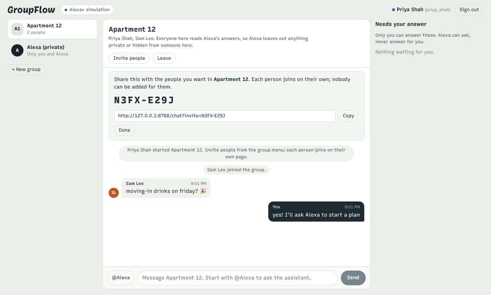
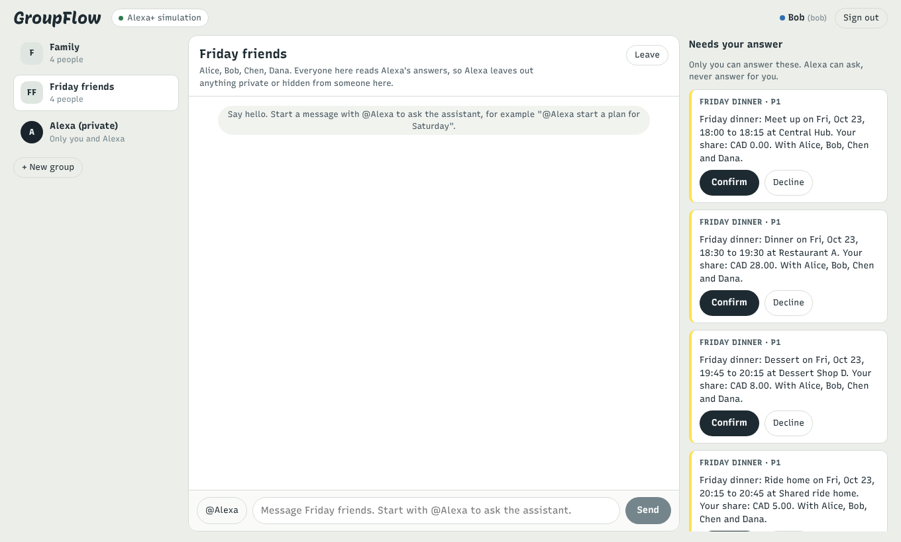

# Group chat: GroupFlow for people outside the demo

GroupFlow is an MCP server; Alexa+ is one host for it. The group chat is a second host on the same server, built so that real people can use GroupFlow today: sign up, start a group, invite friends with a link, talk in a room, and ask Alexa (simulated) to act on their plans. It runs inside the simulator (`python -m groupflow demo`, then open http://localhost:8788/chat).

Most planning between friends already happens in group chats, which is why this host matters: it shows the server working where people actually coordinate, with several people reading every answer. That last part is also the hardest privacy problem in the project, and the server, not the chat, solves it.

## What a person can do

| Step | Where it happens | Why there |
| --- | --- | --- |
| Sign up (name, passcode) or sign in | Their own GroupFlow page (`/human/signup`, `/human/login`) | The passcode never passes through the model; new passcodes are stored with salted scrypt |
| Let Alexa act for them | Their own page (`POST /human/links`), shown in the chat as an explicit consent banner | This is account linking: the host receives a revocable token for that person, as Alexa+ would with OAuth |
| Start a group | The chat, the person's page, or Alexa (`create_group`) | Starting a group adds nobody else, so anyone may ask for it |
| Invite people | The group menu or Alexa (`invite_to_group`), organizers only | A code adds nobody by itself; inviting widens who sees the group's shared plans, so it is an organizer's call |
| Join | The invited person's own page (`/human/invites/accept`, or sign-up with the code) | Joining changes what others can see about the newcomer and what the newcomer sees; only they can do it |
| Talk in the room; ask Alexa with `@Alexa ...` or `Alexa, ...` | The chat | The assistant runs one turn as the person who wrote the message, over that person's own MCP session |
| Talk to Alexa privately | The "Alexa (private)" thread | Private limits, private notes and plans hidden from someone in a room belong here |
| Confirm or decline a plan, verify a private condition | Cards in the chat that call the person's own page | Consent never comes from a message; the tap goes to the human-only API with the person's own session, a one-time challenge and the scope digest |
| Leave a group | Their own page (`/human/groups/leave`) | Visibility of the group's shared plans ends at once; organizing passes to another member |
| Hear what someone asked Alexa to tell them | Their private thread, marked as an update from that plan | The server wrote it for them from a plan they can see; the chat posts it the moment `notify_people` runs |
| Answer Alexa's question with one tap | Quick-answer buttons under the question, for the person who was asked | Tapping says the answer in the conversation, so the model and the server treat it exactly like a typed reply |

The demo world's thirteen people are pre-linked, so judges can open two browser tabs, sign in as Alice and Linda, and watch the family room.





## The privacy problem: everyone in the room reads the reply

On a personal Echo, the reply reaches only the speaker, so the server answers with the speaker's scope. In a group chat the reply reaches everyone in the room. If Alice asks in the family chat "how is Saturday looking?", answering from Alice's scope would read the surprise party out to Linda, and "what budget did I set?" would read Alice's private limit to everyone.

The fix lives in the MCP server, because a host should not have to re-implement GroupFlow's visibility rules:

1. The host declares who else will read the reply with an HTTP header on the MCP connection: `X-GroupFlow-Listeners: group:family` (every active member of that group) or a comma-separated list of member ids. The chat opens one MCP session per person and room with that header.
2. The server resolves it (the speaker must be in the group; unknown ids are refused with 400, so a host bug is visible) and narrows the speaker's scope for that call to the spaces every listener belongs to. A plan someone in the room may not see is not in the conversation at all: reading it by id returns the same NOT_FOUND as a plan that does not exist, and writing to it is impossible.
3. The speaker's own private conditions are left out of the briefing, and a pending "verify your condition" item is described without its value. Notes that belong to no space, or to a space someone in the room is not in, stay unread for the private thread.
4. A plan started in a room must be visible to everyone in it: `create_plan` with `private=true`, or with `hidden_from`/`audience` excluding someone present, returns `SHARED_CONVERSATION` and suggests a private message.
5. `get_context` returns `shared_with` (who else reads the reply) and a short note, so the model can explain why it is not answering something rather than claiming it does not exist.

The declaration can only narrow access, never widen it, so a host that omits it is no less safe than a personal device. The same mechanism fits a shared kitchen Echo: Alexa+ could declare the household as listeners when it cannot tell who is in the room. `docs/PROTOCOL_EVIDENCE.md` shows the real traffic: the same `get_context` call for Alice, with and without the header.

In a room, telling people uses the same rule from the other side: everyone in the room has just read the reply, so `notify_people` for a role (everyone, whoever still has to confirm) skips them instead of sending a duplicate to their private thread. People who are in the plan but not in the room, which is everyone when the request comes from a private thread, get the notice there. See [Telling people and asking first](TELLING_PEOPLE.md).

## How a room turn reaches the model

When a room message addresses Alexa, the chat builds the model's input from the last twelve room messages, labelled as context written by several people, followed by the addressed message. The host prompt adds one paragraph: act only on the message addressed to you, use earlier messages to resolve references ("put Ines down for that"), do not record chatter, jokes or side conversations, and remember that everyone in the chat reads the reply. Alexa's earlier replies in the room are part of that transcript, so a room needs no separate chat memory; the private thread keeps the usual six-turn history.

## Architecture

```
 Browser (/chat)                         Simulator :8788                         GroupFlow server :8787
 ┌──────────────────────┐  /api/chat/*   ┌───────────────────────────┐   MCP    ┌──────────────────────────────┐
 │ rooms, private thread├───────────────►│ ChatService               ├─────────►│ /mcp  bearer = person        │
 │ invite links         │  person's own  │  messages (own SQLite)    │ listeners│       X-GroupFlow-Listeners  │
 │ confirmation cards ──┼── session ─────┼─► /human proxy (keeps     │  header  │ engine: scope narrowed to    │
 └──────────────────────┘                │    nothing)               │          │   what every listener sees   │
                                         │ LlmAgent (one turn per    │          │ /human  signup, links,       │
                                         │   addressed message)      │          │   invites, confirmations     │
                                         └───────────────────────────┘          └──────────────────────────────┘
```

| Piece | File |
| --- | --- |
| Accounts, groups, invites, assistant links | `groupflow/engine/membership.py`, tables in `groupflow/engine/membership_schema.py` (additive `accounts_v1`; older database files upgrade in place) |
| Listener-aware scope | `groupflow/engine/core.py` (`scope_for`, `resolve_listeners`), applied per call in `groupflow/mcp_server/common.py` |
| MCP tools `create_group`, `invite_to_group` | `groupflow/mcp_server/tools.py` |
| Human-only routes | `groupflow/human_api/routes.py` |
| Chat host | `groupflow/sim/chat.py`, mounted by `groupflow/sim/app.py` |
| Room-aware agent turns | `groupflow/sim/agent.py` (`ChatContext`, the group chat prompt paragraph) |
| Web UI | `web/src/chat/` |

## Configuration

| Variable | Default | Purpose |
| --- | --- | --- |
| `GROUPFLOW_SIGNUP` | `open` | `open`, `invite` (sign-up needs an invite code) or `off` |
| `GROUPFLOW_JOIN_URL` | `http://localhost:8788/chat` | Base of the link `invite_to_group` returns; the chat builds links from its own address |
| `GROUPFLOW_CHAT_DB` | next to `GROUPFLOW_DB` (`data/groupflow.chat.db`) | The chat's messages and the tokens people linked to it |

## Tests

`tests/engine/test_membership.py` covers sign-up, invites (hashed, expiring, organizer-only), joining and leaving, linked tokens and the listener restriction at engine level, including a version out for confirmation that must be resent after someone joins. `tests/mcp/test_accounts.py` repeats the important cases over real HTTP and MCP. `tests/sim/test_chat.py` drives the chat API: sign-up, linking, group creation, invite links, joining, live events reaching members only, room turns running with the room's listener session, a family room that never sees the surprise, revoked links, resets, notices landing in each recipient's private thread, and quick answers for the person who was asked.

## Limits

The chat is a demonstration host, not a messaging product. Messages and linked tokens sit unencrypted in the host's SQLite file; a production host would encrypt tokens at rest and use real OAuth for linking. Sign-in is a name and passcode on the person's GroupFlow page, without email verification or recovery. There is no push delivery outside the open page: a notice reaches a person's private thread at once, but they see it when they next open the chat. A person who leaves a group is removed from shared plans, but activities that list them as a participant still need the organizer to update who is coming. Rooms map one to one to groups; there are no sub-group rooms.
