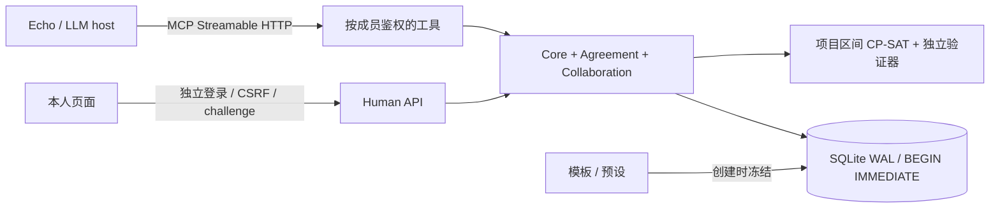

# GroupFlow v0.4：长期项目与可信协作

GroupFlow 把 AgreementOS 的“谁承诺、谁授权、承诺覆盖什么”与 PlanRepair 的“变化后尽量保留已有安排”连在同一条执行路径上。修复结果是提案；服务端要求受影响的人重新确认，再检查跨项目容量，最后才能提交。

这份文档说明已实现的本地版本。企业身份提供商、真实 Alexa+ 账号连接、日历/支付/部署系统属于外部适配边界；本地阶段授权不执行真实付款或上线。

## 1. 通用模板与预设

默认目录展示 8 种通用模板，规格按需读取。

| 模板 | 默认计划窗口 | 用途 |
| --- | ---: | --- |
| `gathering` | 1 天 | party、聚会、社区活动；日期、地点、人数与准备事项 |
| `trip` | 7 天 | 任意行程；默认没有目的地、酒店或三天活动 |
| `meeting` | 1 天 | 会议、工作坊、offsite；议程、准备与出席活动 |
| `shared_tasks` | 14 天，ongoing | 长期家务、志愿者工作、共享清单 |
| `project` | 42 天 | 多工作流交付、里程碑、周期任务、资源与阶段授权 |
| `evening_out` | 1 天 | 带场地目录与条件的晚间活动 |
| `study_group` | 7 天 | 学习安排与准备任务 |
| `general_event` | 1 天 | 自由组合细节、事项、活动与开放清单 |

`days` 是从 `start_date` 起可规划的日历窗口，允许 1–366 的整数，可显式覆盖，例如十天 trip；它不表示审批有效期。`bounded` 是有界计划，`ongoing` 允许滚动近期窗口。项目确认另有 `approval_days`（默认 14 天），且总是绑定具体内容。

预设是显式选择的起点：`gathering + surprise` 强制提供 `hidden_from`，在写内容前建立受限空间；`trip + weekend_cottage` 提供原来的三天合成行程与场地数据。普通 gathering 不自动排除任何人，owner 也不代表私密。

`surprise_party`、`weekend_trip`、`team_meeting`、`chores_shopping` 的旧规格保留在 `templates/legacy/`，仍支持准确 ID 查询和旧 demo。新计划保存模板 JSON/版本快照；之后改 YAML 只影响新计划，不能静默改变已有事项的确认策略。

## 2. 用户故事与范围

- 发布负责人把设计、工程、QA 与治理拆成工作流，指定负责人、截止日期、工时、依赖、成本和实验室需求。
- 工程师只能修改自己的工作估计；负责人可协调分派，但这仍然是草案，不能替负责人给出个人承诺。
- 每周状态报告展开为独立发生实例。移动某一次不会改变其原始发生日期身份，也不会修改整个系列。
- QA 工时增加后，修复器优先保留原开始时间，再减少移动分钟数；不共用人员或资源的事项可并行。
- 每位负责人在自己的页面确认工作范围；workspace approver 单独授权完整阶段和预算。修改后的内容不能使用旧 challenge。
- 两个项目同时尝试预订同一人或设备，提交事务重新读取当前预留；冲突的一方被拒绝，需要再修复。

单个工作单元为一个工作日内连续的 0–480 分钟区块，按 15 分钟网格安排，0 分钟表示里程碑。跨日大任务需拆成有依赖的日工作单元。每个窗口最多 400 个开放工作单元、每次最多展开 200 个周期实例；计算超时返回未知/timeout，不宣称不可行或最优。

## 3. 运行企业 Demo

在项目目录执行，使用单独数据库以保留原五组 demo：

```powershell
.venv\Scripts\python.exe -m groupflow demo --world demo/enterprise.yaml --db data/enterprise.db
```

打开 `http://localhost:8788`。合成世界包含 Ava（负责人/工作区管理员）、Ben（工程）、Mei（设计）、Lee（QA）；这些公开 demo 账号只能用于本地演示。

6 周计划有 18 个工作单元、4 个工作流、2 类共享资源和 19 个初始人工范围（18 个个人承诺 + 1 个阶段授权）。初始状态是 awaiting。页面可筛工作流、翻页、编辑工作、查看资源时间与求解证明。

1. 查看当前工作和资源安排，尝试未确认提交，得到 blocked。
2. 各自登录 Own page，阅读自己的工作范围；Ava 另读完整阶段与预算，分别回答。
3. 提交阶段，生成真实的本地资源预留记录。
4. Ben 把 `Implement API slice` 从 480 改成 450 分钟。
5. Ava 准备修复，检查保留的开始时间，发起新一轮确认。
6. 未变的精确个人范围可沿用有效承诺；Ben 的变更范围和整个阶段授权需要新答案。
7. 新内容确认后再次提交，事务原子替换该项目的预留。

页面的 guided demo 走同样路径。模拟人工步骤明确使用各合成账号自己的 human API，代理没有 human token，也没有批准工具。

## 4. 架构与数据



| 数据 | 内容 |
| --- | --- |
| `plans / items / links` | 原有计划、owner/open/participants 规则、状态与无环依赖 |
| `plan_extensions` | 模板快照、模板版本、预设、生命周期和窗口 |
| `project_config` | 当前阶段、工作日历、授权者、预算、确认期限及当前/已提交 revision |
| `project_work` | 结构化日期、工时、工作流、里程碑、资源数量、依赖与成本；关联已有 task |
| `project_series` | 规则、原始 DTSTART 与实例生成参数；实例用 series + recurrence_id 唯一标识 |
| `workspace_roles / workspace_resources` | lead、approver 与共享设备容量；管理员通过本人页面管理角色 |
| `project_revisions` | 不可变工作和排程快照、输入摘要、内容摘要、求解证明 |
| `project_scopes` | 每项 owner commitment 与完整阶段 authorization 的独立摘要和有效期 |
| `project_challenges / project_receipts` | 短效一次性 nonce、成员绑定、内容/条件/权限指纹与人的答案 |
| `resource_reservations` | 已提交项目中的人员和共享资源 UTC 区间预留 |

新表采用增量创建，原 schema 保持不变。只有识别出的上一版 schema 可以自动升级；未知格式会拒绝打开并要求保留文件，不建议直接重置。DDL 与 schema 标记在同一事务提交。已对现有数据库的只读备份副本检查行数、外键和完整性；原数据库未被迁移测试修改。

## 5. MCP 工具与上下文

原有 16 个通用/发现工具继续工作，新增 5 个项目工具：

| 工具 | 主要契约 |
| --- | --- |
| `get_project` | 按工作流与 offset/limit 读取工作、排程、资源和确认状态；只返回调用者自己的私人日历 |
| `configure_project` | lead 修改阶段策略、预算、授权者及 ongoing 窗口；仅 workspace admin 可定义共享资源容量 |
| `upsert_work` | lead 创建/分派，owner 编辑自己的工时等；ISO 日期、依赖 DAG、资源数量严格校验 |
| `manage_recurrence` | 创建规则或幂等展开；编辑某次发生实例走 `upsert_work(item=...)` |
| `repair_project` | 提议经过独立验证的并行排程，返回最优性证明状态；不发起确认、不提交 |
| `request_confirmations` | 对 project 发起个人承诺与阶段授权；对原活动计划保持原有语义 |
| `commit_plan` | 对 project 重检所有范围与容量并预留；原活动计划继续原确认/预订路径 |

服务端 `tools/list` 始终可发现 21 个工具，权限始终在服务端。**本地模拟器 host** 在普通场景给模型 17 个工具（含 `get_project` 入口），进入项目主题/选中项目/读取 project 模板后再加载 4 个项目写工具的详细 schema。同一轮创建项目后也会激活。真实 Alexa+ host 如何选工具由其自身实现决定，不声称本地策略能控制 Alexa+ 的上下文。

摘要保留有上限的跨计划本人任务、待决和未读事项，单计划详情按需读取。项目计划详情最多显示 12 个任务摘要，其余走 `get_project` 分页；目录不包含 YAML 全文和所有场地。说明适当加长，优先保留否定句、私人便签、开放清单、转述条件和具体动作的例子，不再只追求字符压缩。

## 6. 计划修复算法

项目模型使用 OR-Tools interval 变量：开始时间属于合法本地工作时段对应的 UTC 离散域；固定工时约束 end = start + duration；依赖要求前项结束不晚于后项开始；同一人使用 NoOverlap；共享设备使用 Cumulative 容量约束。其他已提交项目的预留作为固定区间加入。

按顺序优化，并且只有前一目标证明最优后才固定它：

1. 已有排程中开始时间改变的工作单元数。
2. 这些工作的绝对移动分钟总数。
3. 按优先级加权的完成时间总和。

这是对可选择排程的最小变动；用户指定的新工时/成本是固定输入，不由优化器擅自改回。超时但有有效解时标为 feasible 且 `optimal=false`；没有解时标为 timeout；只有证明无解才是 infeasible。每个输出另外检查覆盖、时长、日历、依赖、人员、资源和预算，失败不能发布。

原有出行活动修复器继续按有限候选组合搜索，**16,384 组合**是其 enumeration / CP-SAT 自动切换点。该数字来自旧模型的配对基准；它不适用于项目区间模型。项目始终使用区间 CP-SAT，另有 `benchmark_projects.py` 的规模检查，支持显式 0.05–10 秒预算；400 是工作单元数量上限，绝不表示所有 400 项都能在默认预算内证明最优。

输入捕获与发布之间重新比对摘要，过期结果不能覆盖后来编辑。最终提交在 `BEGIN IMMEDIATE` 中重读其他项目预留、独立验证、删除本项目旧预留并插入新预留；不同连接同时提交也只能有一个占用冲突资源。

## 7. 周期、权限与隐私

周期实现明确支持 RFC5545 的一个子集：DAILY / WEEKLY、INTERVAL、工作日 BYDAY、COUNT 或 UNTIL、EXDATE。不是完整 RRULE 解释器，不支持 MONTHLY/BYSETPOS 等。以本地原始日期作为 recurrence_id，COUNT 先计算再排除 EXDATE。实例独立展开，重跑不覆盖手动例外；ongoing 滚窗只补齐新发生实例，不跨周期复用人的承诺。

日期为 ISO local date，锁定时间和不可用窗口必须含时区偏移；每次发生实例分别通过 ZoneInfo 转为 UTC，覆盖跨月和 DST。共享日历设置工作时段，私有忙碌窗口只能由本人页面设置；其他成员只能看到排程效果。一个项目使用工作区时区，跨时区参与者可用带偏移的不可用时间表示例外。

人工确认使用现有独立登录、12 小时 session、CSRF、10 分钟一次性 challenge；答案绑定成员、内容摘要、条件/成员/角色指纹和有效期。阶段授权还绑定整个排程与成本。MCP 不能批准、拒绝、撤回或授予 workspace role。人的撤回让计划 degraded，旧批准不能越过后来的拒绝/撤回。

事件包括配置/工作变更、修复、发起确认、人工答案、撤回、阶段提交和工作区角色变更，写入既有 audit。个人日历日志只有“可用时间更新”，不含忙碌详情；个人答案详情仅对本人可见，组内确认进度不包含原因。

## 8. 验收与运行边界

测试覆盖并行、容量、依赖、里程碑、无效输入、预算/锁定不可行、过期/重放 challenge、承诺沿用、授权失效、撤回、不同连接同时提交、搜索与编辑竞争、周期幂等/单次例外/滚窗、DST、可见性与真实 MCP + human HTTP。运行：

```powershell
python -m pytest
cd web
npm run build
# 回项目根目录
python -m groupflow eval --out report.md --json report.json
python scripts/evaluate_projects.py --out project-report.json
python scripts/benchmark_projects.py
python scripts/benchmark_projects.py --budget 10 --out docs/project_benchmark_10s.json
```

SQLite 适合本地与小团队演示；不包含企业 SSO/SCIM、多租户生产隔离、外部项目管理同步或真实付款执行。长任务拆分、滚动窗口和求解预算是明确边界。LLM 仍可能误解或漏记意图，所以保留原始失败与复测记录；可见性、人的批准和提交门禁由确定性代码执行。

## 9. 官方依据（2026-10-15 核实）

- [Hackathon Official Rules](https://amazonappdev2026.devpost.com/rules)：MCP 路径要求 2025-11-25 或确认可用的后续版本和 Streamable HTTP；规则也提供独立的模拟 Alexa+ 路径。此项目实现真实 MCP 运行时，再用自己的网页 host 演示。
- [Hackathon FAQ](https://amazonappdev2026.devpost.com/details/faqs)：预览 Alexa+ 开发工具只面向选定合作方，不能把本地模拟器称为官方 Web Simulator 或真实 Alexa+ 认证接入。
- [MCP 2025-11-25 transports](https://modelcontextprotocol.io/specification/2025-11-25/basic/transports)：HTTP/SSE、会话头与 Origin 等要求；本项目用真实 SDK 客户端验收，证据见 `PROTOCOL_EVIDENCE.md`。
- [OR-Tools job shop](https://developers.google.com/optimization/scheduling/job_shop)：区间排程、依赖与资源互斥的建模依据。
- [RFC5545 recurrence](https://www.rfc-editor.org/rfc/rfc5545#section-3.3.10)、[RECURRENCE-ID](https://www.rfc-editor.org/rfc/rfc5545#section-3.8.4.4)：周期边界和发生实例身份的依据；实际支持范围以上述子集为准。
